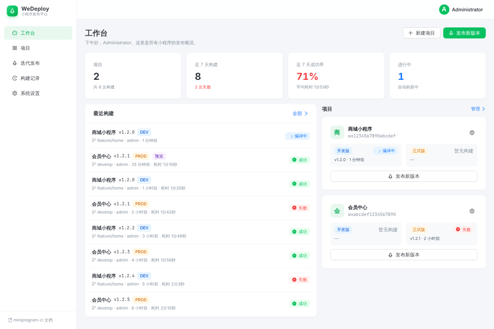

<div align="center">

# WeDeploy

**微信小程序自动化构建与发布平台**

让小程序的构建、上传、预览不再依赖微信开发者工具 ——
迭代化管理、Token / SSH 双认证、Taro 等编译型框架原生支持。

[](./LICENSE)
[](https://nodejs.org)
[](./CONTRIBUTING.md)

</div>

---

## 特性

- **可视化迭代管理**：以「迭代」为单位组织版本号、目标分支、目标环境（dev / prod），一键触发构建。
- **Git 自动拉取**：支持 GitHub / GitLab / Bitbucket / Gitea / Coding 等主流仓库，自动按平台采用正确的 Token 凭证格式（PAT 不再要求二次输入密码）。
- **Token / SSH 双认证**：HTTPS Token 一键使用；SSH 私钥也可指定路径。
- **编译型框架原生支持**：Taro / uni-app / Vue3 等需要先 `npm run build:weapp` 的项目，可在配置里指定 `buildCommand` 与 `miniprogramRoot`，平台会自动在 clone → install → build → upload 的流水线里串起来。
- **基于 miniprogram-ci**：直接调用官方编译模块，支持上传、预览（含二维码）、构建 npm（packNpm）、机器人编号、ES6/ES7/Minify 等编译开关。
- **构建日志实时回流**：每次任务的步骤、状态、子包大小、错误堆栈均落库为 build_logs，前端通过 SSE 实时查看，支持级别筛选、搜索、复制与下载。
- **预览二维码**：任意一次构建都可以一键生成预览版二维码；预览作为独立的构建记录保存，不会影响原上传记录。
- **构建结果通知**：在「系统设置」中配置企业微信群机器人 Webhook，构建成功 / 失败自动推送到群里。
- **构建队列**：全局并发上限可在「系统设置」中调整，超出的构建自动排队。
- **沙盒自动清理**：构建结束（成功/失败）后自动清理 `/data/sandbox` 临时代码，避免占满磁盘。
- **凭证脱敏**：日志、API 错误响应中的 token 自动脱敏为 `***:***@host`，避免密钥外泄。
- **极简部署**：一份 `docker-compose up -d` 即可拉起 web + api 双服务，自带 SQLite 持久化。

## 截图



> 更多界面（项目配置 / 迭代管理 / 构建控制台 / 构建历史等）欢迎提交 PR 补充截图。

## 技术栈

| 层   | 选型                                                              |
| ---- | ----------------------------------------------------------------- |
| 前端 | React 19、Vite、Ant Design 6、Zustand、React Router 7             |
| 后端 | Node.js ≥ 20、Express、better-sqlite3、simple-git、miniprogram-ci |
| 构建 | TypeScript、Less、pnpm、tsx                                       |
| 部署 | Docker、docker-compose、systemd、nginx                            |

## 快速开始（本地开发）

```bash
# 1. 安装依赖
pnpm install
pnpm --dir server install

# 2. 同时启动前后端
pnpm dev:all

# 3. 浏览器访问
open http://localhost:5173
# 首次启动会在后端控制台打印初始管理员密码；也可用 INITIAL_ADMIN_PASSWORD 指定
```

启动后默认监听：

- 前端：<http://localhost:5173>
- 后端 API：<http://localhost:8080>
- 健康检查：<http://localhost:8080/api/health>

> 默认数据库存放在 `server/data/we-deploy.db`，首次启动自动初始化 schema 与 admin 账号；生产环境必须配置 `JWT_SECRET`。

## 项目配置（核心）

进入「项目管理 → 项目配置」即可填写：

| 字段               | 说明                                                       |
| ------------------ | ---------------------------------------------------------- |
| 仓库地址           | 必填，HTTPS 或 SSH，例 `https://github.com/xxx/yyy.git`    |
| 默认分支           | 缺省分支；迭代上的分支会优先生效                           |
| 认证方式           | `token`（HTTPS）/ `ssh`                                    |
| Access Token       | Token 仅落库，保存后不再返回前端，置空表示不修改           |
| **编译命令**       | 编译型框架必填，例 `npm run build:weapp`                   |
| **小程序根目录**   | 编译产物路径（含 `project.config.json`），例 `dist/weapp`  |
| **构建小程序 npm** | 项目使用了小程序 npm 包时打开（即微信工具的「构建 npm」）  |
| 微信 CI 私钥       | 在微信公众平台「开发管理 → 开发设置 → 小程序代码上传」生成 |
| dev / prod 环境    | 机器人编号、ES6/ES7/Minify 等编译开关                      |

构建任务会按以下流程执行：

```
git clone 指定分支
  → npm install（如有 package.json）
  → 执行 buildCommand（如有；编译型框架必经）
  → 解析 miniprogramRoot 校验存在 project.config.json
  → 可选 ci.packNpm（如开启）
  → ci.upload / ci.preview（带 robot、setting、onProgressUpdate）
  → finally: 清理 sandbox 临时目录
```

## Docker 部署（推荐）

```bash
cp .env.example .env       # 必填 JWT_SECRET / APP_ENCRYPTION_KEY（可用 openssl rand -hex 32 生成）
docker compose up -d --build
docker compose logs api | grep "Initial admin password"   # 查看初始管理员密码
```

启动后访问：`http://<server-ip>:${WE_DEPLOY_PORT:-8000}`。

数据持久化目录：`./data`（SQLite + sandbox + 二维码），升级直接 `docker compose up -d --build` 即可保留数据。

容器内部环境变量（详见 `Dockerfile`）：

| 变量                 | 默认值             | 说明                                                                                                    |
| -------------------- | ------------------ | ------------------------------------------------------------------------------------------------------- |
| `PORT`               | 8080               | 后端监听端口（容器内）                                                                                  |
| `HOST`               | 0.0.0.0            | 后端绑定地址                                                                                            |
| `DB_PATH`            | /data/we-deploy.db | SQLite 数据库路径                                                                                       |
| `SANDBOX_BASE`       | /data/sandbox      | git clone 临时目录                                                                                      |
| `QRCODE_BASE`        | /data/qrcodes      | 预览二维码保存目录                                                                                      |
| `CI_PROC_CWD`       | /tmp/we-deploy/ci-proc | miniprogram-ci 执行时的进程工作目录，其临时/缓存文件写入此处，避免落在项目代码目录                                                |
| `JWT_SECRET`        | -                  | JWT 签名密钥；生产环境必填                                                                                 |
| `APP_ENCRYPTION_KEY` | -                 | Git Token、微信 CI 私钥等敏感配置的加密密钥；生产环境必填                                                    |
| `INITIAL_ADMIN_USERNAME` | admin          | 初始管理员用户名（仅在数据库中没有用户时生效）                                                            |
| `INITIAL_ADMIN_PASSWORD` | 随机生成       | 初始管理员密码；不设置则随机生成并打印到启动日志                                                          |
| `MAX_CONCURRENT_BUILDS` | -               | 全局最大并发构建数；设置后覆盖「系统设置」页面中的配置（默认 2）                                          |
| `LOG_RETENTION_DAYS` | 30                 | 构建记录与控制台日志保留天数；早于该阈值的 `builds` 及关联 `build_logs` 会被删除；设为 `0` 关闭自动清理 |
| `WE_DEPLOY_PORT`     | 8000               | web 容器对外暴露端口（仅 docker-compose.yml 中使用）                                                    |

## Linux 裸机部署

适合不希望使用 Docker、希望与现有 nginx 集成的场景：

```bash
# 项目目录下执行（一键安装：node 20 + 编译 + systemd 注册）
sudo bash deploy/install.sh

# 自定义路径
sudo INSTALL_DIR=/srv/we-deploy DATA_DIR=/srv/we-deploy/data bash deploy/install.sh
```

脚本会：

1. 安装 Node.js 20、pnpm、git、build-essential
2. 创建 `we-deploy` 系统用户，将代码同步到 `INSTALL_DIR`
3. 构建前端 `dist/`、后端 `server/dist/`
4. 注册 `we-deploy.service` systemd 单元（含安全加固）
5. 输出宿主机 nginx 反代示例位置：`deploy/nginx.conf.example`

常用运维命令：

```bash
systemctl status  we-deploy
systemctl restart we-deploy
journalctl -u we-deploy -f
```

## API 速览

| 方法   | 路径                        | 说明                             |
| ------ | --------------------------- | -------------------------------- |
| `POST` | `/api/auth/login`           | 登录，返回 JWT                   |
| `POST` | `/api/auth/change-password` | 修改当前用户密码                 |
| `GET`  | `/api/projects`             | 列出项目                         |
| `POST` | `/api/projects`             | 创建项目                         |
| `PUT`  | `/api/projects/:id`         | 更新项目                         |
| `POST` | `/api/git/test-connection`  | 测试仓库连通性（自动注入 token） |
| `POST` | `/api/git/branches`         | 列出远端分支                     |
| `POST` | `/api/iterations`           | 创建迭代                         |
| `POST` | `/api/iterations/:id/build` | 触发构建（异步）                 |
| `PATCH`| `/api/iterations/:id/close` | 关闭迭代（构建中不可关闭）       |
| `PATCH`| `/api/iterations/:id/reopen`| 重新打开已关闭的迭代             |
| `GET`  | `/api/builds/:id/logs/stream` | SSE 实时日志                   |
| `GET`  | `/api/builds/:id/logs`      | 拉取构建日志                     |
| `POST` | `/api/builds/:id/preview`   | 基于该构建新建一条预览构建（生成二维码） |
| `GET`  | `/api/builds/:id/qrcode`    | 获取预览二维码图片               |
| `GET`  | `/api/settings`             | 系统设置 + 运行信息              |
| `PUT`  | `/api/settings`             | 修改系统设置（仅管理员）         |
| `POST` | `/api/settings/test-webhook`| 发送测试通知（仅管理员）         |

详见 `server/src/routes/`。

## 目录结构

详见 [CONTRIBUTING.md](./CONTRIBUTING.md#项目结构)。

## 路线图

- [ ] 多用户 / 多角色（admin / developer / viewer）
- [ ] 构建任务取消
- [x] SSE 实时日志推送（轮询兜底）
- [x] 企业微信构建结果通知
- [ ] 钉钉 / 飞书通知
- [ ] 二维码定期清理任务
- [ ] 单元测试 / e2e 覆盖

## 贡献

欢迎 PR / Issue。开发流程、提交规范请参考 [CONTRIBUTING.md](./CONTRIBUTING.md)。

## 协议

本项目基于 [MIT License](./LICENSE) 开源。商业使用、二次开发均不受限，但请保留版权与免责声明。
